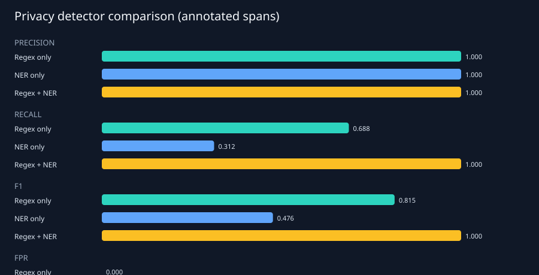

# Phase 5 detection evaluation

Dataset: `tests\fixtures\phase5_eval.json`; 18 synthetic cases across HR, banking, healthcare, university, business, technical resume, and technical project domains.

| Configuration | TP | FP | FN | TN | Precision | Recall | F1 | FPR | Unassessed predictions |
|---|---:|---:|---:|---:|---:|---:|---:|---:|---:|
| Regex only | 22 | 0 | 10 | 30 | 1.000 | 0.688 | 0.815 | 0.000 | 0 |
| NER only | 10 | 0 | 22 | 30 | 1.000 | 0.312 | 0.476 | 0.000 | 0 |
| Regex + NER | 32 | 0 | 0 | 30 | 1.000 | 1.000 | 1.000 | 0.000 | 0 |

Candidate-level outcomes use manually annotated sensitive **and** non-sensitive spans. Predictions not overlapping an annotated candidate are reported as unassessed and are not counted as false positives. Metrics are micro-averaged over the annotated candidate spans. FPR = FP / (FP + TN); precision/recall/FPR are N/A when their denominator is zero. Category mismatches are reported in the JSON/CSV detail.

Results were generated locally by `scripts/evaluate_phase5.py`. The corpus is synthetic and small; these values measure behavior on this corpus, not real-world generalization.
