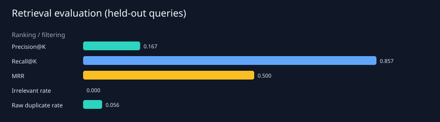

# Phase 5 retrieval evaluation

- Synthetic chunks: 13
- Calibration queries: 12
- Held-out evaluation queries: 12
- K / candidate fetch: 3 / 9
- Current production distance cutoff: 1.500000
- Calibrated cutoff: 0.792107
- Calibration: Maximum candidate-pair F1 on calibration queries; ties minimize FPR, then prefer precision, then the smaller distance threshold.
- Calibration pairwise metrics are available in `phase5_retrieval_calibration.csv`; query-level results are in `phase5_retrieval_metrics.csv`.

| Calibration cutoff | L2 threshold | TP | FP | FN | TN | Precision | Recall | F1 | FPR |
|---|---:|---:|---:|---:|---:|---:|---:|---:|---:|
| Before Phase 5 | 1.500000 | 6 | 27 | 0 | 123 | 0.182 | 1.000 | 0.308 | 0.180 |
| Selected from calibration split | 0.792107 | 6 | 1 | 0 | 149 | 0.857 | 1.000 | 0.923 | 0.007 |

| Metric (held-out split) | Value |
|---|---:|
| Precision@K (fixed K denominator) | 0.167 |
| Recall@K | 0.857 |
| MRR | 0.500 |
| Raw top-K duplicate rate | 0.056 |
| Post-dedup duplicate rate | 0.000 |
| Irrelevant retrieval rate after threshold and dedup | 0.000 |
| Mean Chroma query time | 14.972 ms |

| Held-out ranking metric | Before Phase 5 (1.500) | Calibrated (0.792) |
|---|---:|---:|
| Precision@K | 0.194 | 0.167 |
| Recall@K | 1.000 | 0.857 |
| MRR | 0.583 | 0.500 |
| Irrelevant retrieval rate | 0.682 | 0.000 |
| Duplicate retrieval rate (raw top-K) | 0.056 | 0.056 |

Threshold calibration uses only the labeled calibration split and sweeps observed candidate-pair distances; evaluation queries are held out. The synthetic set is intentionally limited, so the calibrated cutoff is not a production-quality estimate for arbitrary user documents.
